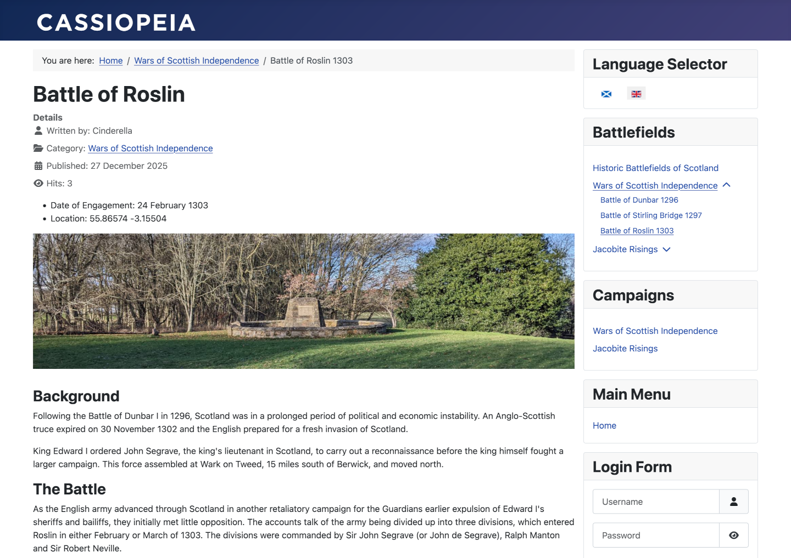

# Demodata Plugins

This folder contains a plugin to install and uninstall demonstration data. There
is a separate module named cefjdemos-mod-demodata required to show the plugins 
in the Administrator Dashboard. 

## Version 0.3+

The plugin structure has changed to provide a number of different data sets:

- Data for UNESCO World Heritage Sites which is now the preferred data set.
- Data for Scottish Battlefields in English and Scottish Gaelic. 

The data is independent of the code so can be replaced with almost anything. 
But beware, data creation is a time-consuming task.

This plugin is a Work in Progress. Some features need more work.

## Setup

- Install Joomla with English-GB as the default language.
- Install one of more of the languages available in a data set
- Enable Content Languages
- Enable System Language Filter
- Create a Language Switcher module.
- Install the Demonstration Data module
- Install and enable the Demodata plugin.
- Configure the plugin to select one of the datasets and one or more languages with en-GB first.
- In the Home Dashboard select the Demonstration Data module Install button.

## In Use

The site frontend may look something like the following:

## Notes

- The contents are stored in language specific subfolders in each dataset (en-gb, de-de, gd-gb, etc).
- The languages to use are set in the plugin Options.
- The item specifications are stored in json files, for example articles.json.
- The article contents are stored in html files, for example battle-of-roslin.html
- Images are stored in language neutral sub-folders and copied to the images folder.

## References

[UNESCO World Heritage List](https://whc.unesco.org/en/list/)
[Inventory of Historic Battlefields in Scotland](https://en.wikipedia.org/wiki/Inventory_of_Historic_Battlefields_in_Scotland)
